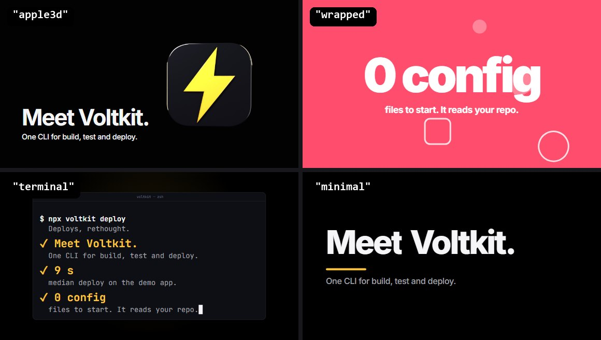
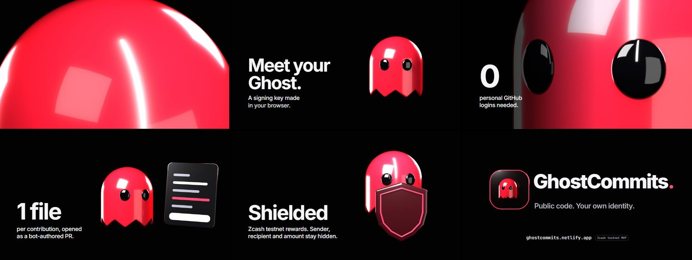

<div align="center">

# 🎬 product-ad-video

**A Claude Code skill that makes product launch videos entirely in code.**

3D product shots scripted in Blender · motion graphics in Remotion · synthesized sound design · AI voiceover
— no video editor, no stock footage, no sample packs.


<sub>An 18-second ad for <a href="https://ghostcommits.netlify.app">GhostCommits</a>, made with this skill. Every frame, sound and voice line came from scripts.</sub>

**▶ Watch with sound:** [GhostCommits 3D](assets/videos/ghostcommits-3d.mp4) · [GhostCommits 2D](assets/videos/ghostcommits-2d.mp4) · [Voltkit 3D (logo + ad.json only)](assets/videos/voltkit-3d.mp4)<br>
<sub>All three are also in the [v1.0.0 release](https://github.com/Dhananjay-alt/product-ad-video-skill/releases/tag/v1.0.0) to download.</sub>

</div>

---

## What it does

Ask Claude Code for a promo video:

> *"Make an 18-second product ad for this repo, 3D style, vertical, with a voiceover."*

Claude reads your project, then runs the same steps a motion designer would:

| Step | What happens | Tool |
|---|---|---|
| **1. Brief** | Reads your README/site, pulls the pitch, proof points, brand colours and logo, and writes down what must **not** be claimed | Claude |
| **2. ad.json** | One small file with the name, tagline, 2–5 stats, colours, style and aspect ratio. Everything else reads from it | Claude |
| **3. Visuals** | **3D:** your SVG logo becomes a glossy 3D object with macro shots, light streaks and depth of field. **2D:** three motion-graphics styles | Blender (headless) / Remotion |
| **4. Sound** | Effects and music synthesized from code, placed on the exact frames of each cut | `scripts/auto_cues.py` |
| **5. Voice** | Short punchy lines in a natural-sounding open-weight voice | `scripts/kokoro_tts.py` |
| **6. Render** | Text overlaid, audio mixed in, exported as MP4 | Remotion |

## Four styles, any logo, any aspect



<sub>The same `ad.json` for a sample product, Voltkit, in each style. Only the `"style"` line changes.</sub>

| Style | Looks like | Good for |
|---|---|---|
| `apple3d` | Your logo as a glossy 3D object in a black void; macro close-ups, light streaks, hard cuts | Products with a strong logo |
| `wrapped` | Loud colour blocks, circle wipes, bouncing type, floating shapes | Consumer apps, fun launches |
| `terminal` | A terminal types your command; each stat prints as a passing ✓ | Dev tools, CLIs, APIs |
| `minimal` | Huge type rising word by word, one accent bar | Serious B2B, infrastructure |

Set `"aspect"` to `landscape` (16:9), `vertical` (9:16 for Reels, TikTok and Shorts) or `square` (1:1). Layouts adapt automatically; in 3D the camera reframes so the logo always clears the text.



<sub>The GhostCommits ad at the top used a fully custom Blender scene (a hand-built mascot with props), included as an advanced example.</sub>

## Quick start (without Claude)

```bash
cp -r plugins/product-ad-video/skills/product-ad-video/template my-ad && cd my-ad && npm i
# edit ad.json, put your logo at public/logo.svg
blender -b --factory-startup -P ../plugins/product-ad-video/skills/product-ad-video/scripts/logo_ad.py -- ad.json anim public/frames   # apple3d only
python ../plugins/product-ad-video/skills/product-ad-video/scripts/auto_cues.py ad.json
npx remotion render Ad out/ad.mp4
```

Your logo must be an SVG of filled shapes; convert strokes and text to paths first. A dark rounded square behind a coloured mark (app-icon style) looks best in 3D.

## Why code instead of an editor

- **Reproducible:** change one line in the storyboard or a colour token and re-render.
- **Reviewable:** the whole ad is text, so it diffs, versions and goes through PRs.
- **License-free audio:** all 16 sound effects and the music are generated, not sampled.
- **Honest by default:** the skill makes Claude list claims to avoid (beta, testnet, "anonymous", user counts) and checks every line against that list.

## Install

In Claude Code (2.1.275 or later), one command:

```text
/plugin install product-ad-video --marketplace Dhananjay-alt/product-ad-video-skill
```

Or in two steps, on any version:

```text
/plugin marketplace add Dhananjay-alt/product-ad-video-skill
/plugin install product-ad-video@product-ad-video-skill
```

Then, in any project:

```text
/product-ad-video:ad
/product-ad-video:ad terminal vertical voice
```

Or just ask in plain words: *"make a launch video for this repo"*. The skill loads on its own.

<details>
<summary>Install as a plain skill instead (no plugin)</summary>

Clone the repo and copy the skill folder into a skills directory: `~/.claude/skills/` for all projects, or `<repo>/.claude/skills/` for one.

```bash
git clone https://github.com/Dhananjay-alt/product-ad-video-skill.git
mkdir -p ~/.claude/skills && cp -r product-ad-video-skill/plugins/product-ad-video/skills/product-ad-video ~/.claude/skills/
```

</details>

### Requirements

| | Needed for |
|---|---|
| Node.js 18+ | Remotion, installed per project by the skill |
| Python 3 with `numpy` and `scipy` | Sound design |
| [Blender](https://www.blender.org/download/) 4.2+ | 3D style only |
| Internet connection | Hosted Kokoro voice only (optional) |

## Use the scripts on their own

Both scripts work without Claude, from the repo root.

**Generate voiceover lines** (one line per row in a text file; Python standard library only):

```bash
python plugins/product-ad-video/skills/product-ad-video/scripts/kokoro_tts.py lines.txt vo/ am_michael af_heart
```

**Score a video from a cue sheet:**

```bash
python plugins/product-ad-video/skills/product-ad-video/scripts/score.py cues.json
```

```jsonc
{
  "out": "soundtrack.wav",
  "fps": 30, "duration": 18.0,
  "end_frame": 494,    // the end-card hit; the music resolves here
  "break_frame": 406,  // drums drop out for the build-up
  "cues": [
    { "frame": 0,   "sound": "swell",  "args": [1.3], "gain": 0.35 },
    { "frame": 76,  "sound": "whoosh", "kwargs": { "dur": 1.1 }, "gain": 0.5 },
    { "frame": 494, "sound": "impact", "gain": 0.9 }
  ],
  "voiceover": [ { "file": "vo/vo-1.wav", "start": 0.6 } ]
}
```

Available sounds: `whoosh` `air` `suck` `swell` `riser` `pop` `tick` `click` `thud` `impact` `cut_hit` `chime` `lock` `glint` `morph` `hum`.
It prints loudness per second, so you can sanity-check the mix without listening.

## What's inside

```
.claude-plugin/marketplace.json   the marketplace (one plugin)
plugins/product-ad-video/
├── .claude-plugin/plugin.json
└── skills/
    ├── ad/SKILL.md           /product-ad-video:ad, the one-command entry point
    └── product-ad-video/     the skill itself
        ├── SKILL.md                  the workflow Claude follows
        ├── template/                 Remotion project: copy it, edit ad.json, render
        │   ├── ad.json               name, tagline, shots, colours, style, aspect
        │   ├── public/logo.svg       your logo goes here
        │   └── src/styles/           Apple3D · Wrapped · Terminal · Minimal
        ├── scripts/
        │   ├── logo_ad.py            Blender: any SVG logo → 3D ad frames
        │   ├── auto_cues.py          ad.json → soundtrack (style-aware cues + music + voice)
        │   ├── score.py              hand-written cue sheet → soundtrack
        │   ├── kokoro_tts.py         text → voice clips via hosted Kokoro
        │   └── adspec.py             shared ad.json reader + shot timing
        ├── references/
        │   ├── storyboard.md         shot-list template
        │   ├── remotion-2d.md        2D motion patterns: easing, staggering, type sizes
        │   ├── blender-3d.md         the "Apple ad" look: lights, materials, camera, gotchas
        │   ├── sound.md              what each sound is for, gains, loudness targets
        │   └── voiceover.md          voice options compared, line-writing tips
        └── examples/ghostcommits/    the real files behind the GhostCommits ads
            ├── storyboard-v1.md      2D ad storyboard
            ├── GhostAdV1.tsx         2D ad, fully hand-animated in Remotion
            ├── storyboard-v2.md      3D ad storyboard
            ├── ghost_scene.py        Blender scene: modelling, lighting, camera, render
            ├── GhostAdV2.tsx         Remotion text overlay and end card
            ├── cues-v2.json          the sound cue sheet
            └── vo-lines.txt          the voiceover script
```

## Voice options

Tried while making the example, best first:

1. **ElevenLabs:** most natural; the free tier is often busy.
2. **Kokoro** *(default)*: open-weight, free, close to ElevenLabs for short lines. The example uses `am_michael`.
3. **Your own voice:** a phone in a quiet room often wins for indie launches.
4. **OS voices** (Windows SAPI, macOS `say`): instant but robotic. Not recommended.
5. **No voice:** the 3D style works with music and effects alone.

## Notes

- The Kokoro script uses the public [hexgrad/Kokoro-TTS](https://huggingface.co/spaces/hexgrad/Kokoro-TTS) demo, which may change. To run it locally instead: `pip install kokoro soundfile`.
- Borrow styles, not brands: the skill won't recreate another company's actual ad, logo or music.
- Claude can't hear audio. Timing and levels are checked numerically, so give the result a listen.

## Credits

Built while making the launch ads for [GhostCommits](https://ghostcommits.netlify.app), with [Claude Code](https://claude.com/claude-code).
Uses [Remotion](https://www.remotion.dev), [Blender](https://www.blender.org) and [Kokoro](https://huggingface.co/hexgrad/Kokoro-82M) (Apache-2.0).

## License

[MIT](LICENSE). Note that Remotion has its own [license terms](https://www.remotion.dev/license) for companies.
